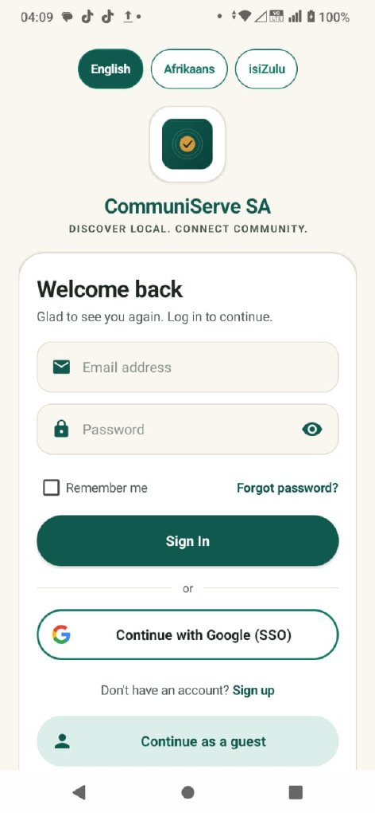
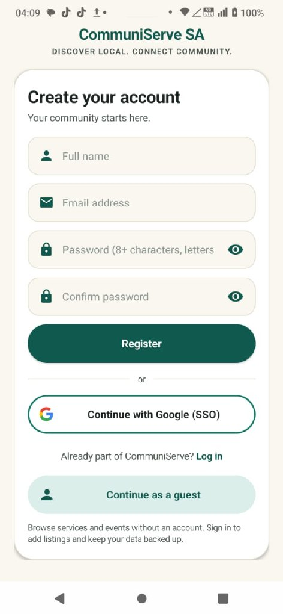
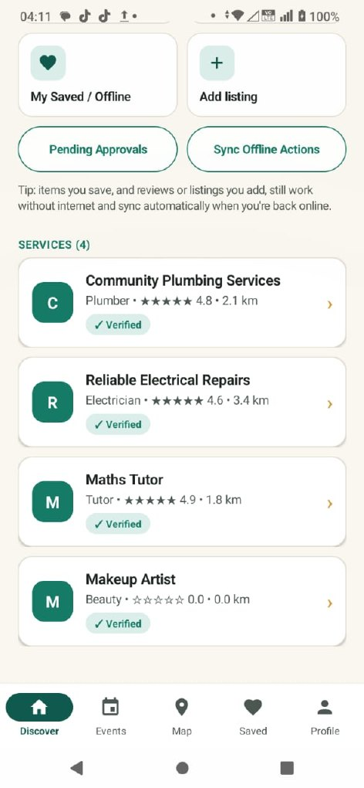
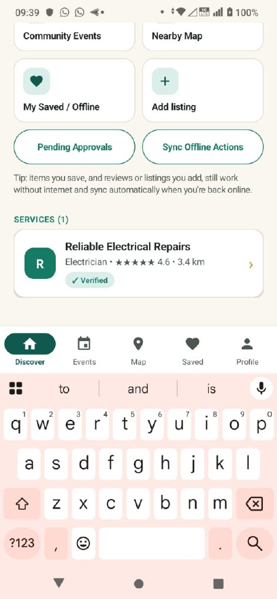
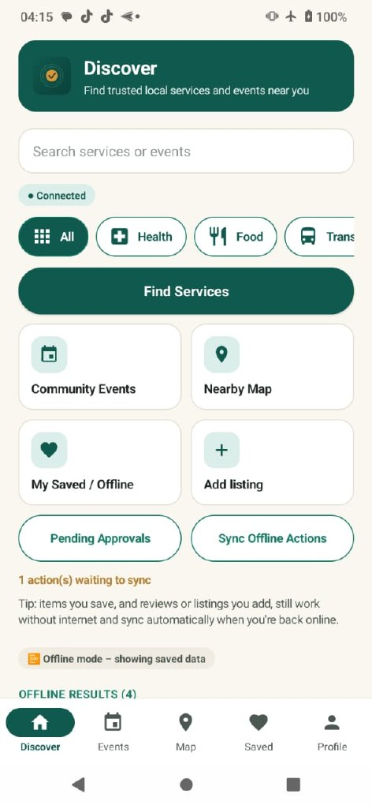
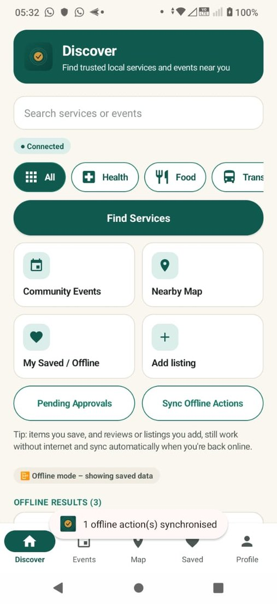
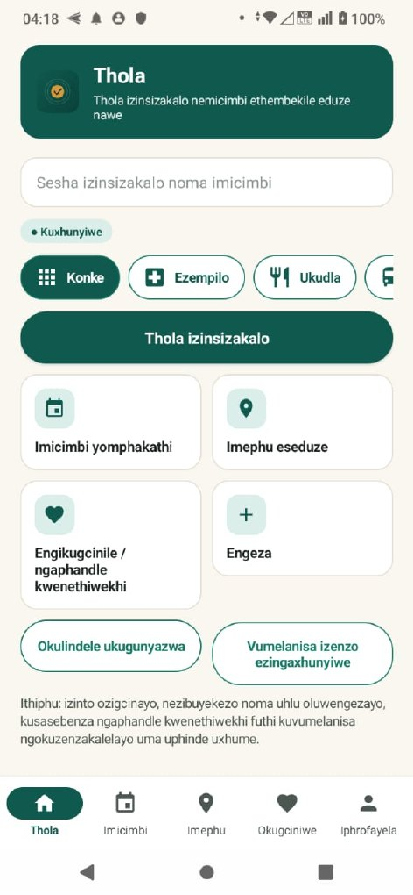
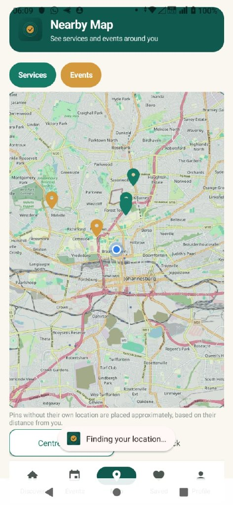

# CommuniServe SA

A community services app for South Africa: discover local services and events, add your own listings, and keep working offline. Android (Kotlin) app plus a Node.js/Express API.

**Module:** OPSC6312 – Part 3 PoE

| Member | Student number |
|---|---|
| Precious Moloi | ST10452719 |
| Nyiko Matladi | ST10450403 |
| Luvuyo Yizani | ST10442920 |
| Naledi Paballo Tshelane | ST10446045 |

- **video:** [Watch on Google Drive](https://drive.google.com/file/d/18ZCTxWemuMIgkK7kuQ48zESAB-PWvqfS/view?usp=drivesdk)
- **Hosted API:** https://communiservesa.onrender.com/ (Render free tier – the first request after idle takes about 50 seconds)
- **CI:** [Android CI – green on master](https://github.com/PreciousMoloi/CommuniServeSA_Part3_POE/actions/runs/42015101975)

## Features
- Register and sign in (email/password via our API with bcrypt + JWT) and **Google single sign-on** (Firebase Authentication, verified server-side).
- **Discover** with unified search for services and events, category chips, and near-me shortcuts (health, food, transport, repairs, cleaning) that open Google Maps.
- **User-defined feature 1 – Nearby map:** OpenStreetMap with service and event pins and device location.
- **User-defined feature 2 – Community listings with moderation:** add a listing, see it under Pending Approvals, approve it, and it appears in the list.
- **Offline mode:** Room cache; reviews and listings made offline are queued and synced when back online.
- **Push notifications** with Firebase Cloud Messaging.
- **Three languages:** English, Afrikaans, isiZulu; settings (radius, dark mode) persist.
- Friendly validation and error messages; edge-to-edge layout with bottom navigation.

## Screenshots
| Login | Register | Discover | Search |
|---|---|---|---|
|  |  |  |  |

| Offline queue | Sync | isiZulu | Map |
|---|---|---|---|
|  |  |  |  |

More in [docs/TEST_EVIDENCE.md](docs/TEST_EVIDENCE.md).

## Testing
- API: `cd server && npm test` → 11/11 pass.
- Android: `.\gradlew.bat testDebugUnitTest` → 31 tests, 0 failures; `.\gradlew.bat assembleDebug` builds.
- Physical phone: 15 of 16 manual tests pass; TC-09 is a documented hosting limitation (below).

## Google Play readiness
Publishing needs a one-off US$25 developer fee. As instructed by our lecturer, we documented every sign-up step up to the payment screen: [docs/PLAY_STORE_EVIDENCE.md](docs/PLAY_STORE_EVIDENCE.md). The signed release APK, store graphics, privacy policy and listing text are ready.

## Hosting note
The API stores data in `server/data/db.json`. Render's free tier has an ephemeral disk, so a restart or redeploy resets the data. The restart-persistence test passes locally; a paid persistent disk or a database would remove this limitation.

## Run it
1. API: `cd server && npm install && npm start` (set `JWT_SECRET`, `FIREBASE_PROJECT_ID=communiservesa-sa`).
2. Android: add your own `app/google-services.json`, open in Android Studio, run on a device. See [docs/FIREBASE_SETUP.md](docs/FIREBASE_SETUP.md).
3. Release build: see [docs/PLAY_STORE_PUBLISHING.md](docs/PLAY_STORE_PUBLISHING.md).

## Documents
[Release notes](RELEASE_NOTES.md) · [Test evidence](docs/TEST_EVIDENCE.md) · [AI use write-up](docs/AI_USE_WRITEUP.md) · [Play Store evidence](docs/PLAY_STORE_EVIDENCE.md) · [Privacy policy](docs/PRIVACY_POLICY.md) · [Deploy API](docs/DEPLOY_API_RENDER.md) · [Postman plan](docs/POSTMAN_TEST_PLAN.md) · [Final report](docs/CommuniServeSA_Part3_Final_Report.pdf)
