# Google Play Store – Publishing Readiness Evidence

**Requirement (lecturer):** the PoE requires publishing on Google Play, which needs a one-off **US$25** developer registration fee. Following the lecturer's instruction, we took a screenshot of each step up to the payment step to show the app is ready to be published.

We stopped at the **"Complete your purchase – Developer Registration Fee US$25.00"** dialog (step 17). Personal details (emails, phone number, street address) are blurred.

## Account set-up steps (Google Play Console)

| # | Step | Picture |
|---|---|---|
| 1 | Choose an account type | 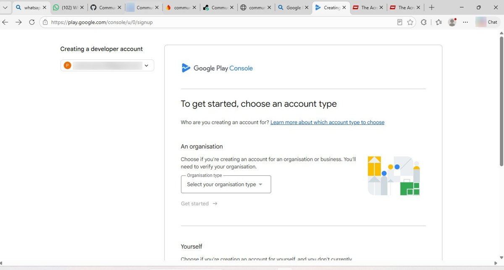 |
| 2 | Choose "Yourself" (personal account) | 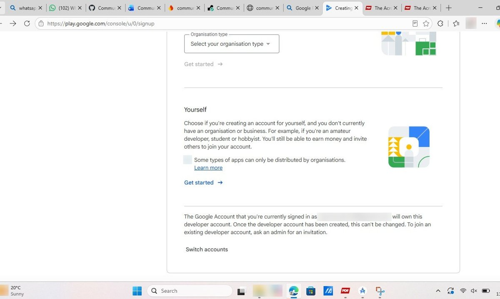 |
| 3 | What you'll need (email, phone, US$25 fee) | 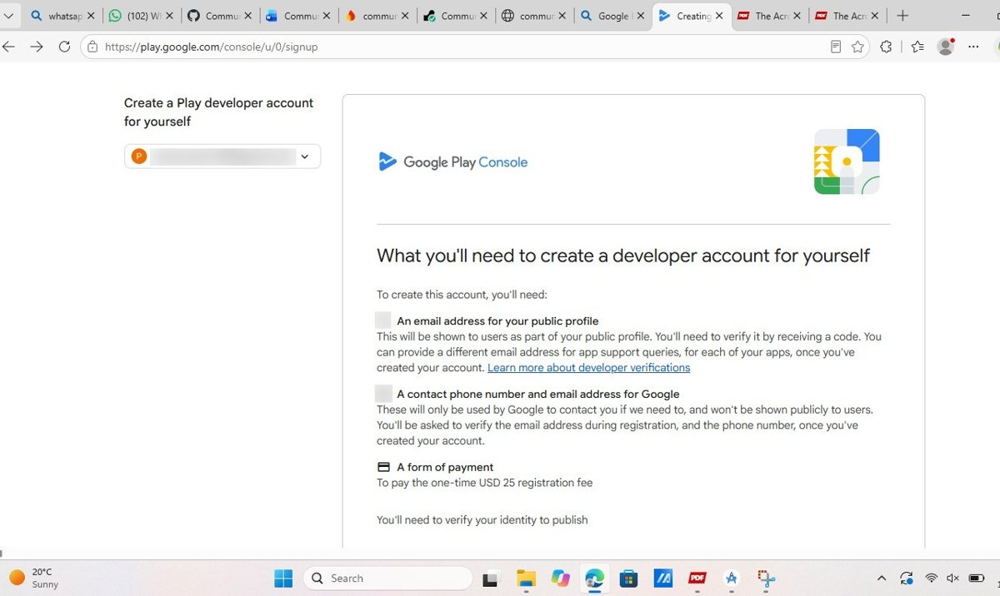 |
| 4 | Developer name | 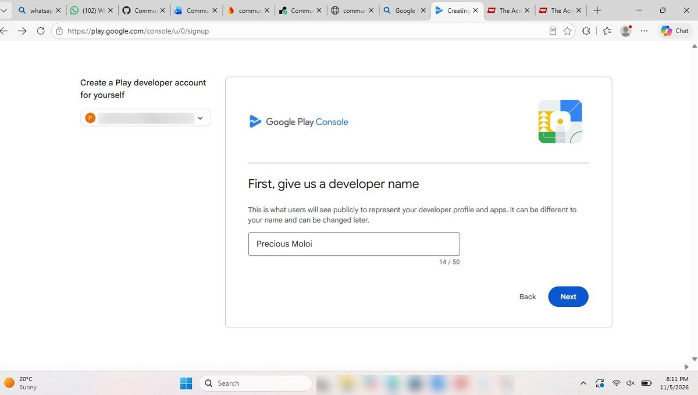 |
| 5 | Link a payments profile | 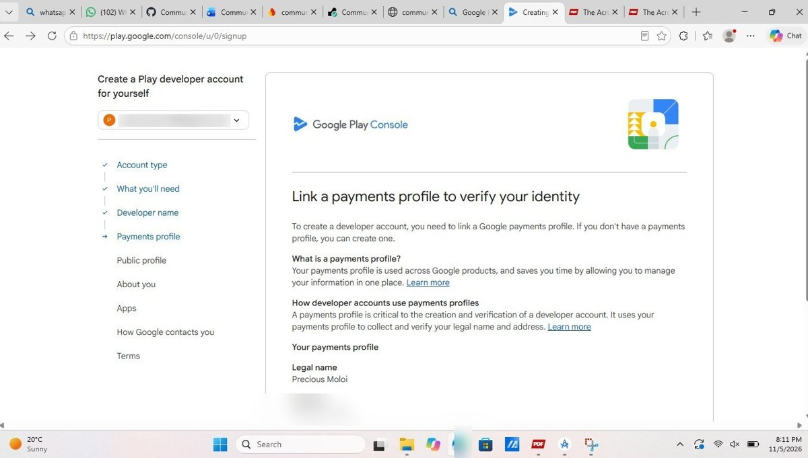 |
| 6 | Payments profile confirmed | 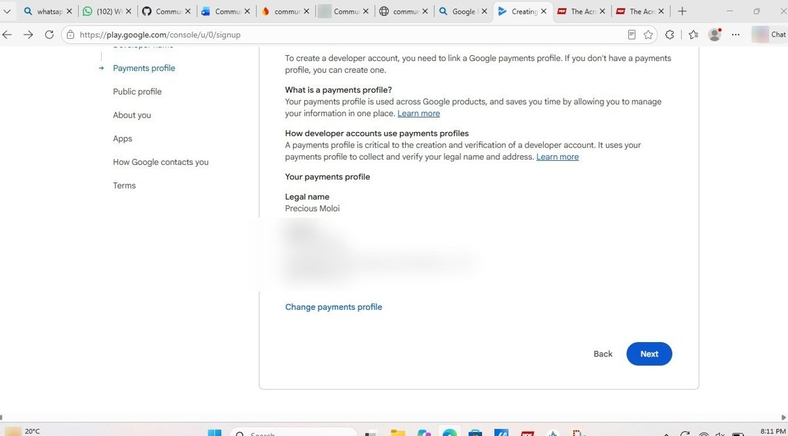 |
| 7 | Public profile | 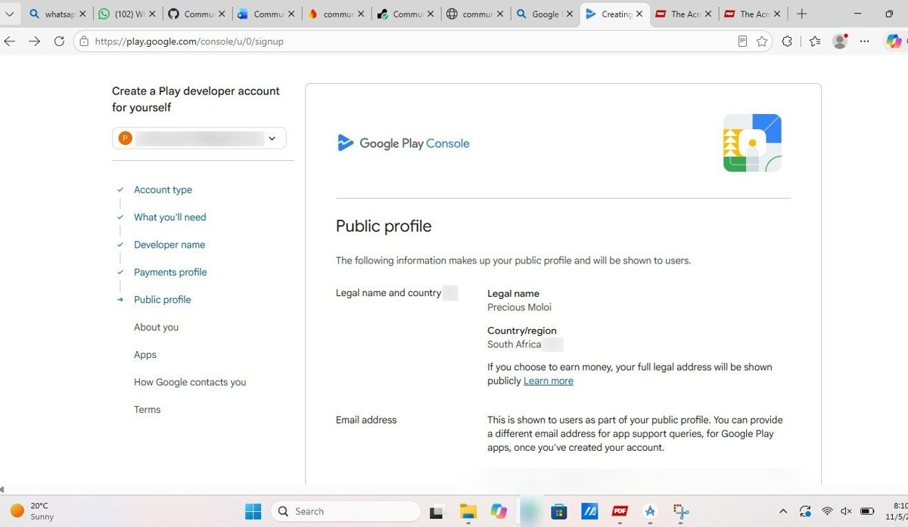 |
| 8 | Public profile consent | 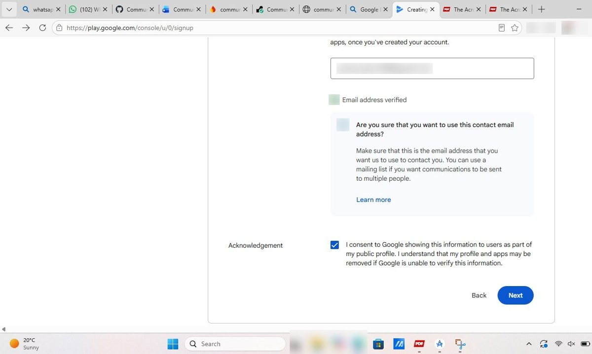 |
| 9 | About you (Android experience) | 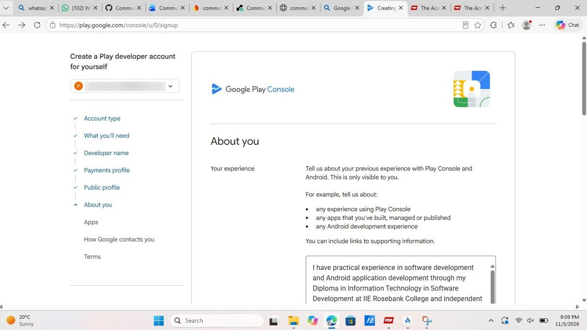 |
| 10 | Other Google accounts | 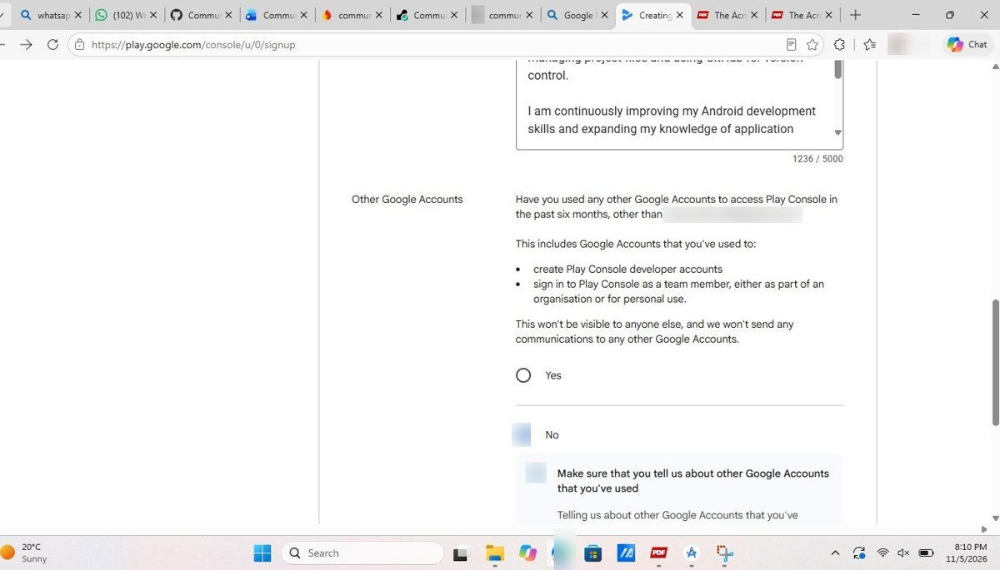 |
| 11 | Apps (number of apps, earning money) | 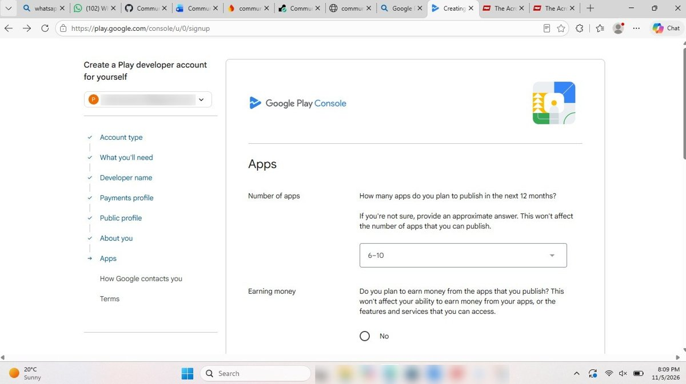 |
| 12 | Website | 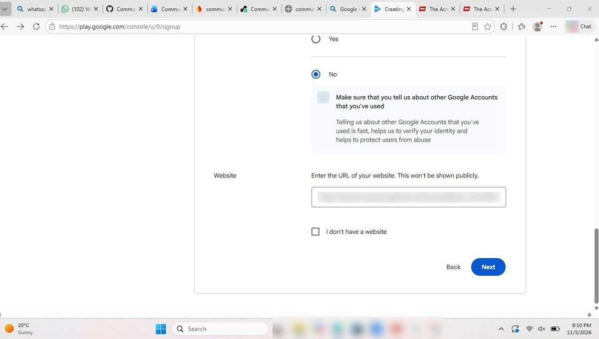 |
| 13 | How Google contacts you | 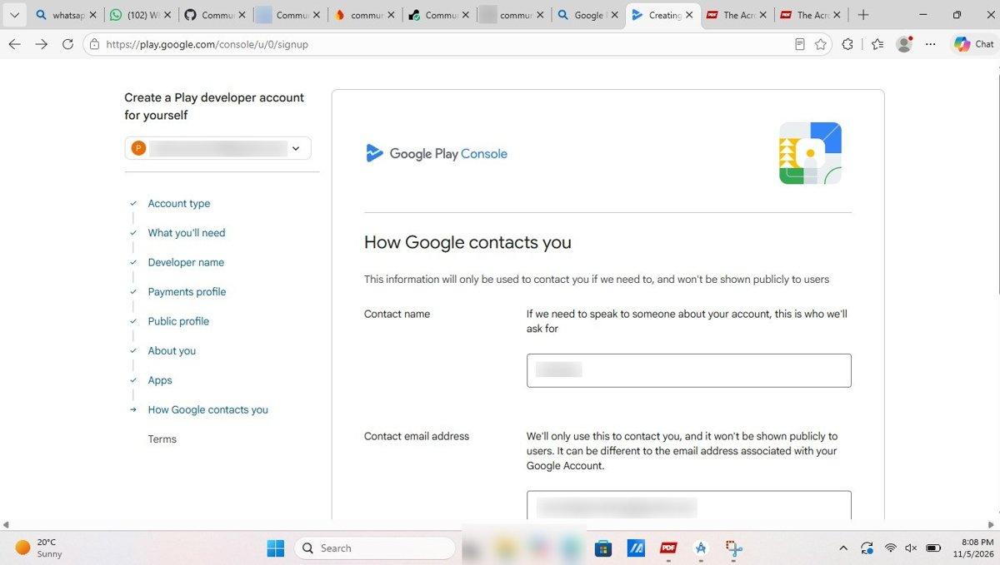 |
| 14 | Contact phone number | 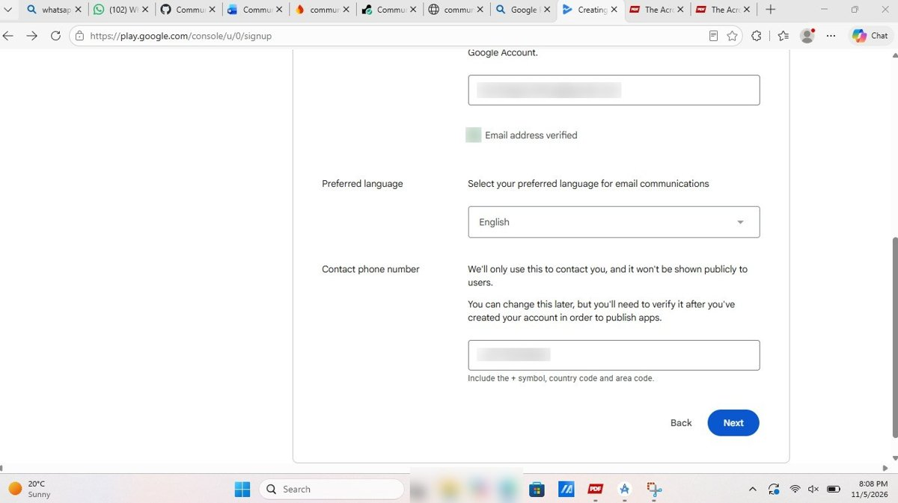 |
| 15 | Terms accepted | 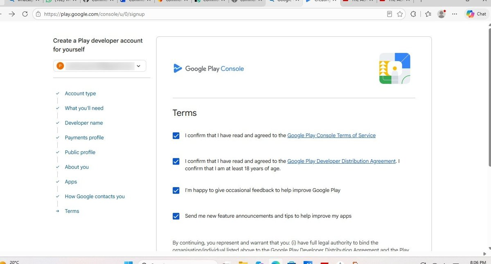 |
| 16 | Registration fee notice – "Create account and pay" | 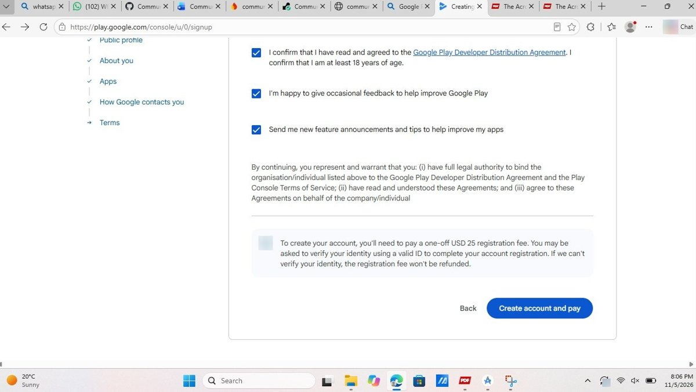 |
| 17 | **Complete your purchase – US$25.00 (stopped here)** | 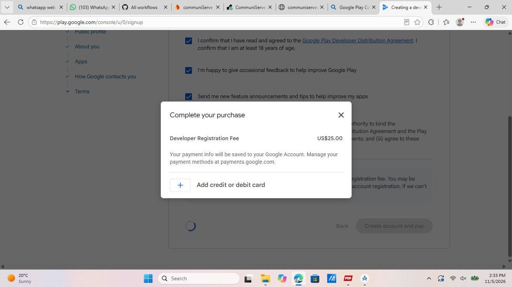 |

## What is already ready for the store

| Requirement | Status | Where |
|---|---|---|
| Signed release APK | Done | `docs/test-evidence/signed-release-apk.jpg` |
| Release build uses HTTPS API | Done | `app/build.gradle.kts` |
| Target SDK 36, version 3.0 (code 3) | Done | `app/build.gradle.kts` |
| App icon 512x512 and feature graphic 1024x500 | Done | `docs/store/` |
| Privacy policy | Done | `docs/PRIVACY_POLICY.md` |
| Store listing text and publishing steps | Done | `docs/PLAY_STORE_PUBLISHING.md` |
| Phone screenshots for the listing | Done | `docs/screenshots/` |
| Automated tests and CI | Green | `docs/TEST_EVIDENCE.md` |
