# CommuniServe SA – Test Evidence (Part 3)

All results below were recorded on **5 November 2026** on a physical Android phone (not an emulator), a Windows development PC, and GitHub Actions. Typed passwords in screenshots are masked.

Status key: PASS / FAIL (known limitation).

## A. Automated tests

| ID | Command | Covers | Actual result | Status | Evidence |
|---|---|---|---|---|---|
| AT-01 | `cd server && npm test` | health, validation, register/login, duplicate email, wrong password | 11 tests, 11 pass, 0 fail (Node v26.8.1, Windows) | PASS | `docs/test-evidence/server-tests-pass.jpg` |
| AT-02 | `npm test` | SSO: valid token OK, forged token 401, missing token 400 | included in the 11 passing tests | PASS | same |
| AT-03 | `npm test` | protected routes: missing / malformed / tampered JWT give 401 | included in the 11 passing tests | PASS | same |
| AT-04 | `npm test` | listings need auth and stay hidden until approved; review validation; device token | included in the 11 passing tests | PASS | same |
| AT-05 | `npm test` (persistence.test.js) | data survives a real server restart | First run FAILED on Windows (test stopped the server before its 100 ms save). Test now waits 500 ms; retest 11/11 pass | PASS | `server-tests-first-run-fail.jpg`, `server-tests-pass.jpg` |
| AT-06 | `.\gradlew.bat testDebugUnitTest` | validators, translations, data contracts, SSO request body | BUILD SUCCESSFUL; 31 tests, 0 failures | PASS | `android-unit-test-report.jpg`, `gradle-tests-and-build.jpg` |
| AT-07 | `.\gradlew.bat assembleDebug` | app compiles to an APK | BUILD SUCCESSFUL in 33 s | PASS | `gradle-tests-and-build.jpg` |
| AT-08 | `testDebugUnitTest` (ServerConfigTest) | emulator alias never used on a physical phone | included in the 31 passing tests | PASS | `android-unit-test-report.jpg` |
| CI | GitHub Actions "Android CI" | API tests, Android unit tests, debug build on every push | Green on `master`: https://github.com/PreciousMoloi/CommuniServeSA_Part3_POE/actions/runs/42015101975 | PASS | `github-actions-runs.jpg` |
| REL | signed release build | release APK signed with the group keystore | Signed release APK produced | PASS | `signed-release-apk.jpg` |

## B. Manual tests on a physical phone

| ID | Scenario | Expected | Actual result | Status | Picture |
|---|---|---|---|---|---|
| TC-01 | Register a new account | Account created, session started | 'Account created successfully'; Discover shows Connected. (First attempt returned 404 because of a wrong default API address – defect 12.) | PASS | `01-login`, `02-register`, `05-discover` |
| TC-02 | Register with an existing email | Rejected with a clear message (HTTP 409) | 'You already have an account with this email. Try signing in instead.' No crash. | PASS | `25-duplicate-email` |
| TC-03 | Log in with a wrong password | Access denied (HTTP 401), no crash | 'We couldn't sign you in. Check your email and password…'; the correct password then signs in. | PASS | `24-login-wrong-password` |
| TC-04 | Search for a service | Matching services and events; empty state if none | 'Electrician' returns Reliable Electrical Repairs; 'zzz' shows 'No services matched your search.' Results appear without scrolling. | PASS | `06-search-electrician`, `07-search-no-results` |
| TC-05 | Save a service, then go offline | Saved item still visible offline | Saved item shown with 'Offline mode – showing saved data'. | PASS | `12-offline-mode-queue` |
| TC-06 | Submit a review while offline | Review queued, 'N actions waiting' | 'You're offline. Your review is saved and will be sent when you're back online.' | PASS | `11-offline-review-saved`, `12-offline-mode-queue` |
| TC-07 | Reconnect | Queue syncs once, no duplicate | '1 offline action(s) synchronised' | PASS | `13-offline-sync-success` |
| TC-08 | Change language | Every screen translates | English, Afrikaans and isiZulu on Discover and Profile | PASS | `14-language-isizulu`, `15-language-afrikaans`, `16-profile-isizulu` |
| TC-09 | Restart the API | Users, reviews, listings still present | **FAIL (known limitation).** The API persists to `server/data/db.json` and the automated restart test (AT-05) passes, but the Render free tier has an ephemeral disk, so a redeploy or restart wipes the file. | FAIL – hosting limitation | `render-redeploy-logs.jpg` |
| TC-10 | Google SSO | Account appears in Firebase Authentication > Users; API returns JWT | Account chooser, 'Signed in with Google', status Connected; user listed in Firebase Console. | PASS | `03-google-account-chooser`, `04-google-signed-in`, `firebase-authentication-users` |
| TC-11 | Push notification from Firebase Console | Notification arrives | Console test message arrived on the phone at 12:29. | PASS | `20-push-notification` |
| TC-12 | Invalid input | Validation messages, no crash | Weak password, bad email and mismatched passwords each show a friendly message. | PASS | `21-validation-weak-password`, `22-validation-bad-email`, `23-validation-password-mismatch` |
| TC-13 | Change settings, restart app | Settings persist | 25 km radius and dark mode still set after signing in again. | PASS | `17-settings-dark-mode` |
| TC-14 | Password reset | Honest message (API returns 501) | 'Password reset by email isn't available yet. Please contact support.' | PASS | `26-forgot-password` |
| TC-15 | Submit a listing, then approve it | Appears under Pending Approvals; after approval it appears in the list | 'Makeup Artist' submitted, shown as PENDING, approved, then listed. | PASS | `08-add-listing`, `09-pending-approvals`, `10-listing-approved` |
| TC-16 | Nearby map | Pins and location permission | OpenStreetMap with service and event pins; location permission dialog. | PASS | `18-nearby-map`, `19-location-permission` |

**Summary:** 10 automated checks pass; 15 of 16 manual tests pass; TC-09 is a documented hosting limitation (not a code defect).

## C. Defects found and corrected

| # | Defect | Fix | Retest |
|---|---|---|---|
| 1 | `npm test` could not discover tests | script now `node --test test/*.test.js` | pass |
| 2 | `/api/auth/sso` trusted an unverified email | API verifies the Firebase ID token | pass (AT-02) |
| 3 | Default JWT secret in code | required in production, random in dev | pass |
| 4 | CORS open to every origin | closed unless `CORS_ORIGINS` set | pass |
| 5 | Forgot-password claimed a link was sent | returns 501 and is disclosed | TC-14 |
| 6 | Earlier report described storage and SSO inaccurately | report rewritten to match the code | reviewed |
| 7 | Limited Google session gave a generic warning | clear explanation plus Retry Connection | phone |
| 8 | Discover actions in one stack | grouped, category chips and tiles | phone |
| 9 | Physical phone used the emulator address `10.0.2.2` | `ServerConfig`, warm-up ping, one SSO retry | phone: Connected |
| 10 | `persistence.test.js` failed on Windows | wait 500 ms before stopping server | 11/11 |
| 11 | Hosted API was the old v2.0 (no `/api/auth/sso`) → 404, Limited mode | redeployed v3.0 with `FIREBASE_PROJECT_ID`; Retry repeats the SSO exchange | phone |
| 12 | Wrong default API URL (`communiservesa-api`) | corrected in `app/build.gradle.kts`; friendly 404 message | phone |
| 13 | Bottom navigation overlapped system buttons | fallback insets padding | phone |
| 14 | Search results and events hidden below the fold | unified search for services and events; results scrolled into view | phone |
| 15 | `ERR_SERVICE_MOVED` unresolved reference | `Strings.kt` updated together with `MainActivity.kt` | build |
| 16 | Duplicate nested `res/drawable/drawable` folder caused resource errors | inner folder deleted | build |
| 17 | Raw technical errors shown to users | plain-language messages in EN/AF/ZU | phone |

## D. Picture gallery

Screenshots are in `docs/screenshots/` and tool evidence in `docs/test-evidence/`.

| | | |
|---|---|---|
| 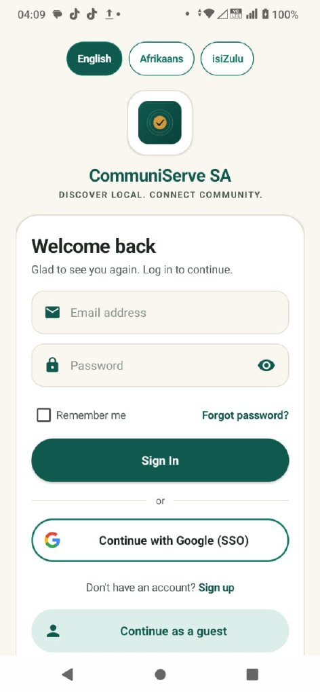 Login | 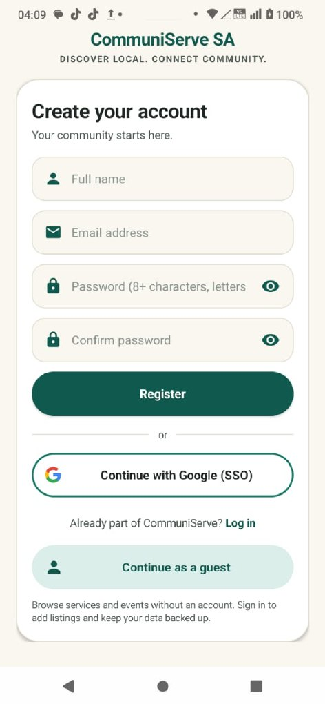 Register | 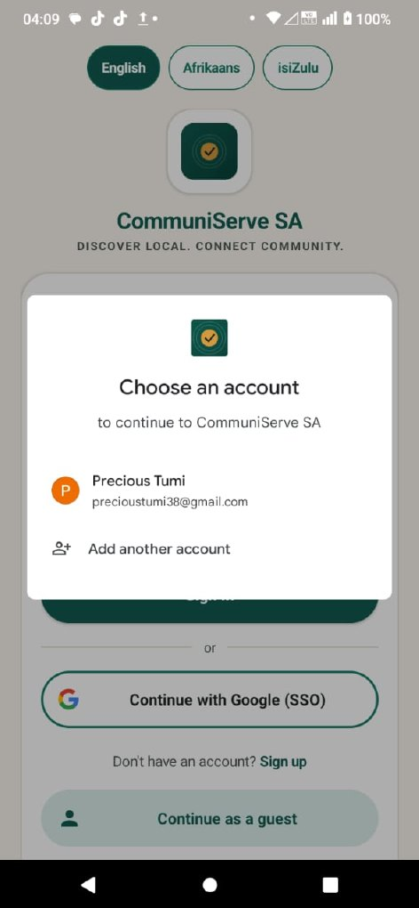 Google chooser |
| 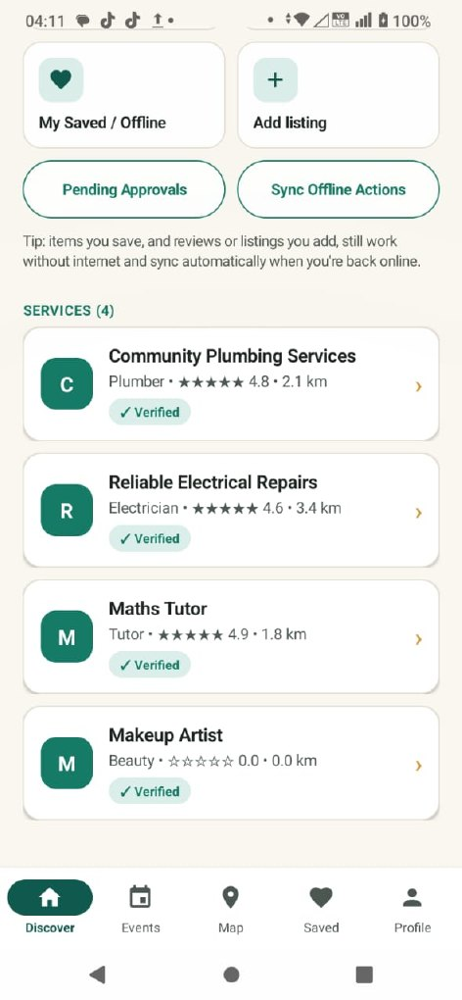 Discover | 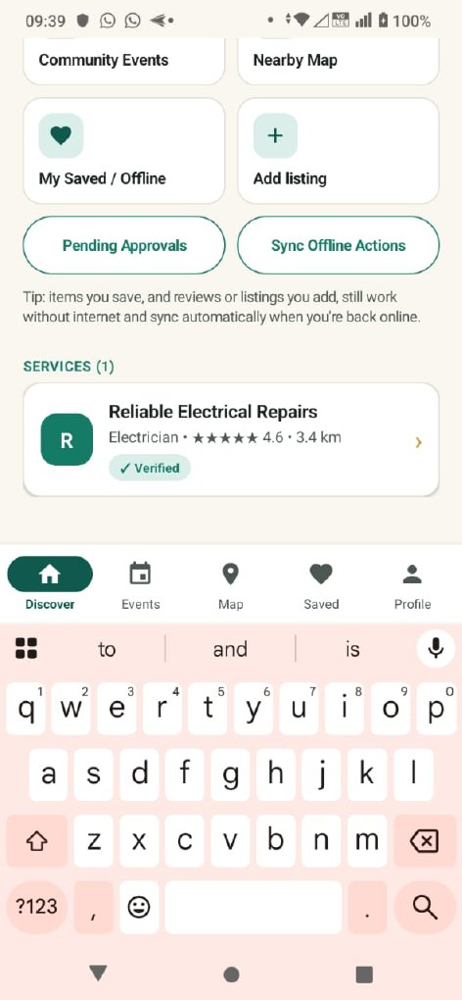 Search | 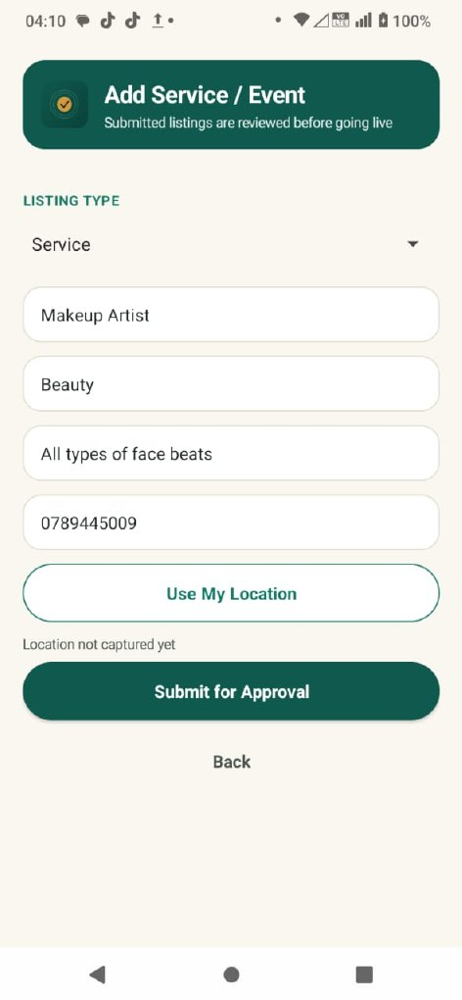 Add listing |
| 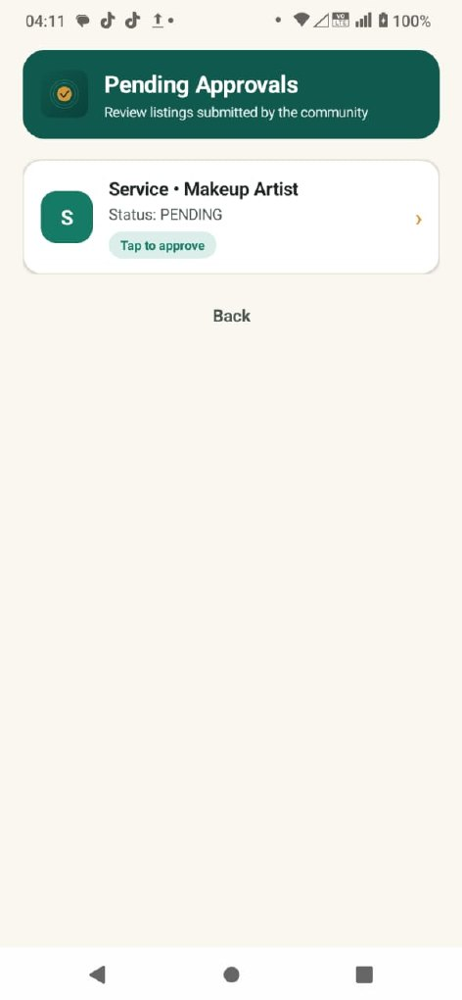 Approvals | 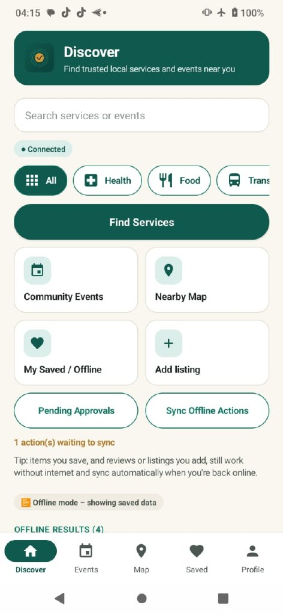 Offline queue | 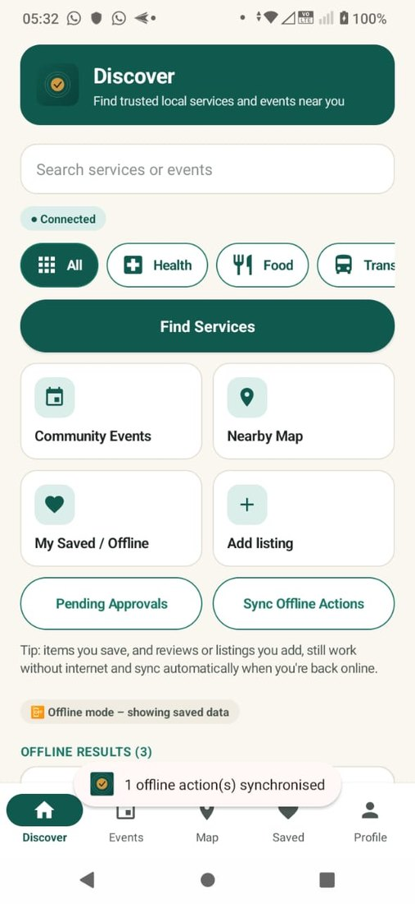 Sync |
| 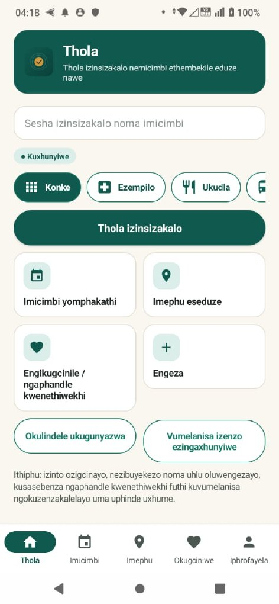 isiZulu | 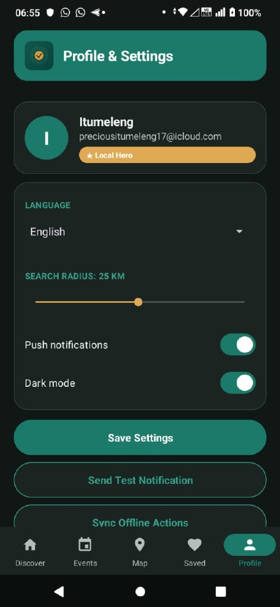 Dark mode | 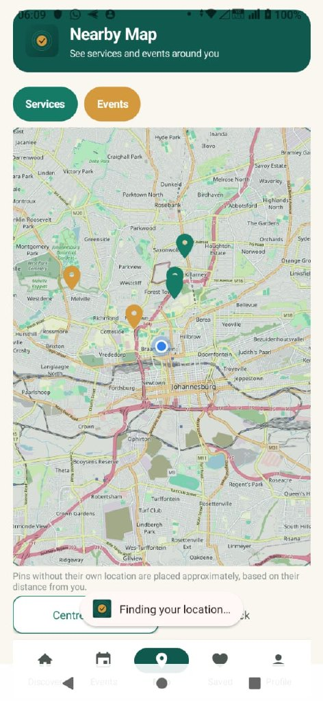 Map |

Tool evidence: 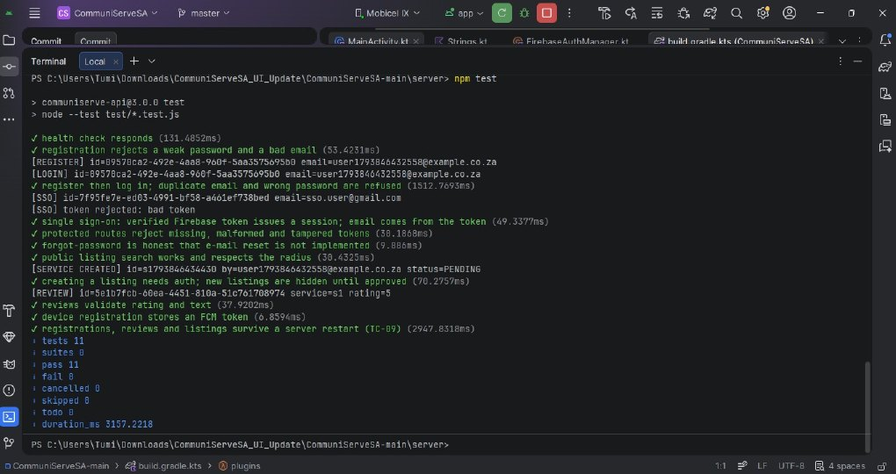 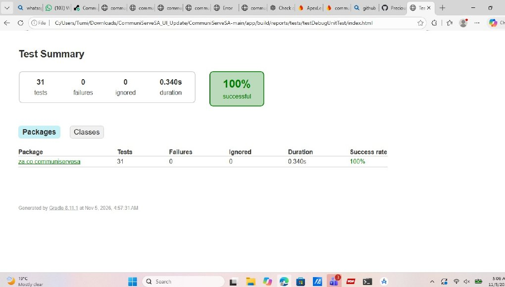 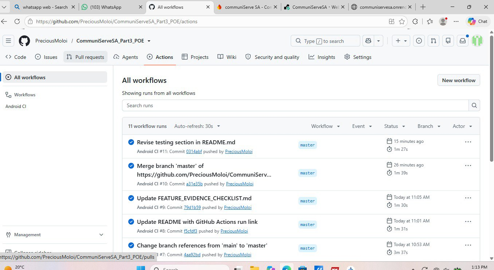
